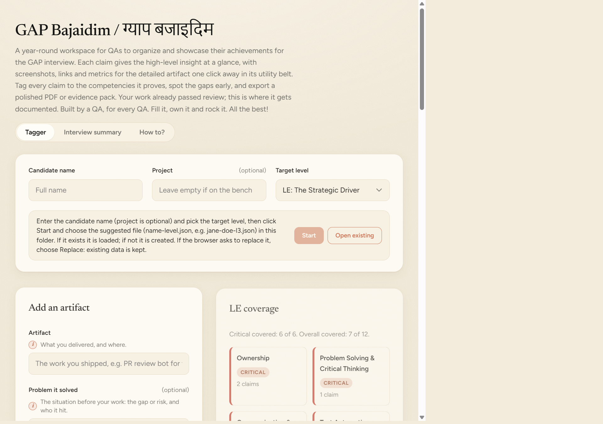

# GAP Handim

A single-file tool that helps QAs organize, tag and export their achievements for the GAP interview.

## Folders

- `view/`: the app. Open `view/gap-handim-tagger.html` in Edge or Chrome.
- `source/`: your data files, including the file the agent writes.
- `images/`: screenshots used in this README.
- `source-deck/`: the original GAP deck. Do not edit.
- `knowledge/`: the GAP competency matrix knowledge base.

## Steps

1. Open `view/gap-handim-tagger.html` in Edge or Chrome.
2. Enter the candidate name. Project is optional. Pick the target level. Each level shows only its own artifacts and coverage. ASE has no tier list yet.
3. Click **Start**. Save or choose the suggested file, for example `your-name-l3.json`.
   - Existing file: it is loaded.
   - New file: it is created.
   - If asked to replace, choose **Replace**. Your data is kept.
4. Add an artifact:
   - **Artifact**, **Problem it solved** and **Description**: required.
   - **Competencies**: required. Tick what the work proves.
   - **Claim story** (optional): drafted from your fields. Edit it, or clear it to resume automatic updates.
   - **Impact** (optional): before, after, and how it was measured.
   - **Proof** (optional): links, screenshots or a flow.
5. Click **Save artifact**. Red tiles in Coverage are critical competencies with no evidence yet. Save is blocked until the required fields and one competency are filled.
   - Short on time? Enter the artifact name, the problem and a few words of description, then click **Suggest competency touched**. It ticks likely competencies (keyword match; check each).
   - Agent drafts are tagged Draft and stay out of Coverage, the PDF and the Markdown export until you edit them and click **Save artifact**.
   - **Copy for agent** copies the artifact for the `gap-artifact-polisher` agent (see below).
6. Edit or delete artifacts as needed. Drag the grip on an artifact to reorder it.
7. Export:
   - **Export PDF** or **Export Markdown** opens a save dialog in your data file's folder. If the dialog cannot open, the file downloads instead.
   - Both use all ready artifacts for the current level. Files are named `<candidate>-<level>-evidence.pdf` or `.md`.

## Artifact order

The order you set by dragging is saved in your data file. It sets the artifact numbers in the PDF and the order of the Markdown export.

## Draft claims with the agent (optional)

Use the `gap-artifact-polisher` agent in Copilot Chat to draft claims from your notes. Notes you paste go to Copilot. Do not paste confidential customer data.

1. In Copilot Chat, choose `gap-artifact-polisher`.
2. Paste a document with one block per artifact: Point, Problem, Before, After, Consequence, Method (estimates only) and Proof.
3. Complete any artifacts the agent lists as incomplete. It drafts the rest.
4. Confirm the drafts. The agent writes `source/your-name-le.json`.
5. In the app, click **Open existing** and choose that file. If it is already open, click **Reload**.

Draft mode is for unfinished artifacts. Paste the output of **Copy for agent** and say "draft" (the agent also uses it when required items are blank). The agent skips the required-items gate, saves the artifact with `status: draft`, ranks competencies with knowledge base references, offers wording, and asks one question per missing item. It never fills in numbers or proof.

### Required and suggested

- You provide: Point, Problem, Before and After (each with a number and unit), Consequence, and Proof (a link or image path). Add Method when Before is an estimate or "no baseline".
- The agent suggests: the claim line, description bullets, competencies (first is primary), and figure and proof status. Check them in the review.

### Limits

- Links are not opened.
- The agent does not invent numbers, links or competencies, and does not change existing claims.
- Claims from the agent carry `createdAt` set to 2026-11-06, not the real date. To change it, edit the JSON and click **Reload**.

## How suggestions and the claim story work

The app has no AI model. Both features are rule-based, run offline and send nothing anywhere.

- **Suggest competency touched** searches the artifact name, description, problem, consequence, before, after and method for trigger words. Each competency has specific trigger words, for example "regression" for TST and "pipeline" for CID, and generic ones, for example "risk" for TPS. Matches in the artifact name or problem count double. A competency is ticked when it has a specific match, or a generic match in the name or problem. It ticks up to five, strongest first, and ties go to the critical tiers. Check each tick.
- **Claim story** is built from the artifact name, problem, description, one sentence per ticked competency and the outcome. It updates as you type until you edit it. Clear the box to return to automatic updates. The empty box shows an example as placeholder text.
- To change the trigger words, edit `COMPETENCY_HINTS` in `view/gap-handim-tagger.html`.

## Backup and reload

- Click **Backup** to download a copy of your data file.
- Edited the JSON by hand? Click **Reload**.

## Troubleshooting

| Problem                                         | Fix                                                                                     |
| ----------------------------------------------- | --------------------------------------------------------------------------------------- |
| Start is greyed out                             | Enter the candidate name.                                                               |
| Access refused                                  | Click **Grant access** and choose Allow. If there is no prompt, IT policy may block it. |
| "File changed outside the app"                  | The file was reloaded. Review and save again.                                           |
| "This browser cannot create or save data files" | Open the app in Microsoft Edge or Chrome.                                               |
| Export PDF downloads a file                     | The save dialog could not open. Find the PDF in your Downloads folder.                  |
| Where is my data?                               | Only in your JSON file. Keep a backup.                                                  |
